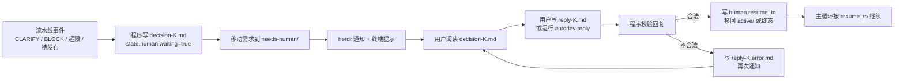

# AutoDev 数据规范

依据：全局规范 `DATA_MODELING_AND_FLOW_STANDARD.md` v1.0。流程设计见 `docs/design/2026-11-02-autodev-design.md`，决策见 `docs/DECISIONS.md`。

审查规则优先级（2026-11-08）：D019 已允许降级与简单复用免审；本文既有审核 verdict 和转移格式尚未描述这些新路径。后续协议需明确记录审核、降级、免审及其依据，不能把无审核记录伪造成 PASS；本轮不改变已有数据或运行代码。

## 1. 总则

1. 所有权威数据都是磁盘上的文件。程序不在内存中保存权威状态。
2. 每类文件有唯一写者（见第 3 节）。非写者只读。
3. 机器读写的文件用 JSON（`*.json`、`*.jsonl`），人和 Agent 读写的文件用 Markdown 加 YAML frontmatter。程序只解析 frontmatter 和 JSON，不解析 Markdown 正文。
4. 每个 JSON 文件和每份 frontmatter 都带 `schema_version`，当前为 `1`。程序遇到不认识的版本时拒绝处理，并把需求转入 needs-human。
5. 写入一律原子化：写 `<file>.tmp`，fsync，rename 为目标文件。`events.jsonl` 例外，用追加写，每行一条完整 JSON，以换行结尾。
6. 时间一律为带时区的 ISO 8601，例如 `2026-11-02T23:10:05+08:00`。
7. 文件内不得出现密钥、token、cookie、密码。Agent 产物中出现疑似密钥时，确定性检查判为失败。

## 2. 数据分层

| 层 | AutoDev 中对应的数据 | 说明 |
| --- | --- | --- |
| raw | 需求原文 `requests/*/<id>.md` 的正文、用户回复原文、Agent 终端日志 `pane.log` | 原样保留，不改写 |
| staging | 跳过 | 输入来自用户本人和受控 Agent，格式已约定，无需单独清洗层 |
| canonical | `state.json`、需求 frontmatter、`done.json`、各产物 frontmatter | 程序只依据这一层做流转 |
| derived | `events.jsonl`、`input.md`（由程序组装）、统计 | 可由 canonical 与 raw 重新生成或核对 |
| output | 决策请求 `decision.md`、herdr 通知、目标项目中的提交、标签、CHANGELOG | 面向用户或目标项目 |

## 3. 实体与写者

| 实体 | 文件 | 写者 | 读者 |
| --- | --- | --- | --- |
| Config | `config.yaml` | 用户（直接编辑或经 Web 界面） | 程序、Web 界面 |
| Request | `workspace/requests/<status>/<id>.md` | 用户创建正文（直接建文件、命令或 Web 界面）；程序只改 frontmatter 的 `status` 相关字段并移动文件 | 程序、analyst |
| RunState | `workspace/runs/<id>/state.json` | 程序 | 程序 |
| Event | `workspace/runs/<id>/events.jsonl` | 程序 | 程序、用户 |
| StepInput | `.../<stage>/round-N/input.md` | 程序 | Agent |
| StepOutput | `.../<stage>/round-N/<产物>.md` | 对应角色的 Agent | 程序（只读 frontmatter）、下游 Agent |
| DoneMarker | `.../<stage>/round-N/done.json` | 对应角色的 Agent | 程序 |
| CheckResult | `.../S5-check/round-N/check.json` | 程序 | 程序、coder、code_reviewer |
| DecisionRequest | `workspace/runs/<id>/human/decision-K.md` | 程序 | 用户 |
| HumanReply | `workspace/runs/<id>/human/reply-K.md` | 用户 | 程序 |

`<id>` 格式：`R` + 日期 + 序号，例如 `R20261102-001`。由程序领取需求时分配，用户在 inbox 中的文件名可以任意，领取后统一改名。

## 4. Request（需求文件）

### 4.1 用户提交时

用户只需写 `project` 和正文，其余字段由程序补齐。

```markdown
---
project: personagent
title: 对话列表支持按标签筛选
priority: normal
---

对话列表现在只能按时间排序。希望顶部加标签筛选，可以多选……
```

### 4.2 程序领取后

```markdown
---
schema_version: 1
id: R20261102-001
project: personagent
title: 对话列表支持按标签筛选
priority: normal
submitted_at: 2026-11-02T23:10:05+08:00
original_filename: tag-filter.md
---

（正文保持用户原文，不改写）
```

### 4.3 字段字典

| 字段 | 含义 | 类型 | 必填 | 默认值 | 取值 / 校验 | 来源 | 层 |
| --- | --- | --- | --- | --- | --- | --- | --- |
| schema_version | 结构版本 | int | 是 | 1 | 等于 1 | 程序 | canonical |
| id | 需求编号 | string | 是 | 程序分配 | `^R\d{8}-\d{3}$`，全局唯一 | 程序 | canonical |
| project | 目标项目 | string | 是 | 无 | 必须存在于 `config.yaml` 的 `projects[].name` | 用户 | canonical |
| title | 标题 | string | 否 | 正文首行，截断到 60 字 | 1–60 字 | 用户或程序 | canonical |
| priority | 优先级 | enum | 否 | normal | `low` / `normal` / `high` | 用户 | canonical |
| submitted_at | 领取时间 | datetime | 是 | 领取时刻 | ISO 8601 带时区 | 程序 | canonical |
| original_filename | 用户原文件名 | string | 是 | 无 | 用于追溯 | 程序 | raw |
| 正文 | 需求原文 | markdown | 是 | 无 | 非空 | 用户 | raw |

校验失败（缺 `project`、项目不存在、正文为空）时，文件不领取，移到 `needs-human/`，并按第 9 节生成一条决策请求，说明原因。

## 5. RunState（state.json）

### 5.1 样例

```json
{
  "schema_version": 1,
  "id": "R20261102-001",
  "project": "personagent",
  "kind": "pipeline/design",
  "status": "active",
  "stage": "S3",
  "round": 2,
  "step": {
    "state": "running",
    "role": "design_reviewer",
    "agent": "codex",
    "model": null,
    "dir": "S3-design-review/round-2",
    "pane_id": "p-7",
    "started_at": "2026-11-02T23:41:00+08:00",
    "deadline_at": "2026-11-03T00:41:00+08:00",
    "attempt": 1,
    "fail_reason": null
  },
  "counters": {
    "design_review_rounds": 2,
    "check_rounds": 0,
    "code_review_rounds": 0,
    "acceptance_rounds": 0
  },
  "git": {
    "branch": "autodev/R20261102-001",
    "worktree": "~/code/.worktrees/personagent/R20261102-001",
    "base_commit": "a1b2c3d",
    "round_start_commit": null,
    "head_commit": null,
    "rc_tag": null,
    "release_tag": null
  },
  "human": {
    "waiting": false,
    "pending_decision": null,
    "resume_to": null
  },
  "updated_at": "2026-11-02T23:41:00+08:00",
  "seq": 17
}
```

### 5.2 字段字典

| 字段 | 含义 | 类型 | 必填 | 取值 / 校验 |
| --- | --- | --- | --- | --- |
| kind | 需求类型，路径写法，大类/子类，如 `pipeline/design` | string | 新记录必填；老记录没有，读取时按“未分类”，不猜 | 必须是 `src/cockpit/kinds.py` 里已登记的；未登记的在写文件前被拒绝 |
| status | 需求总状态 | enum | 是 | `active` / `needs-human` / `done` / `rejected`；必须与需求文件所在目录一致 |
| stage | 当前阶段 | enum | 是 | `S1`–`S9` |
| round | 当前阶段轮次 | int | 是 | ≥ 1 |
| step.state | 步骤状态 | enum | 是 | `pending` / `running` / `finished` / `failed` |
| step.role | 当前角色 | enum | 程序步骤为 null | 设计文档第 3.1 节的角色名 |
| step.agent | 实际使用的 Agent | string | 同上 | `config.yaml` 中 `agents` 的键；记录启动时的值，配置后改不影响已启动步骤 |
| step.model | 实际使用的模型 | string | 否 | 同上 |
| step.dir | 本步骤目录 | string | 是 | 相对 `runs/<id>/` |
| step.pane_id | 旧字段：herdr pane | string | 否 | **2026-11-06 起新记录不再写**（F6 移除窗格驱动）；老记录里仍可能有，读取时忽略 |
| step.deadline_at | 超时时刻 | datetime | running 时必填 | `started_at + step_timeout_minutes` |
| step.attempt | 本步骤第几次尝试 | int | 是 | 1 到 `step_retries + 1` |
| step.fail_reason | 失败原因 | enum | failed 时必填 | `timeout` / `pane_lost`（旧记录） / `invalid_output` / `command_failed` / `agent_blocked` |
| counters.* | 各关口已用轮次 | int | 是 | 不超过 `config.yaml` 对应上限；用户 `continue` 时由程序清零 |
| git.base_commit | 开始时目标分支提交 | sha | 建 worktree 后必填 | |
| git.round_start_commit | 本轮编码开始时的提交 | sha | S4 时必填 | 重做编码前回到此提交 |
| human.waiting | 是否等待用户 | bool | 是 | 为 true 时 `status` 必须为 `needs-human` |
| human.pending_decision | 待回复的决策编号 | string | waiting 时必填 | 如 `decision-1` |
| human.resume_to | 用户回复后的去向 | object | 否 | 由程序解析回复后写入，见第 10 节 |
| seq | 写入序号 | int | 是 | 每次写入加 1；必须等于 `events.jsonl` 最后一行的 `seq` |

不变量（每次启动和每次写入前校验，不满足则停止处理该需求并报告）：

1. `status` 与需求文件所在目录一致。
2. `seq` 与 `events.jsonl` 最后一条的 `seq` 一致。
3. `step.state = running` 时，`started_at`、`deadline_at` 非空（`pane_id` 已不再写）。
4. 任一 `counters.*` 不超过对应上限。

### 5.3 写入顺序

每次状态变化按固定顺序执行，保证崩溃后可判断进度：

1. 追加一行 Event 到 `events.jsonl`（带新的 `seq`）。
2. 原子写 `state.json`（带相同的 `seq`）。
3. 如需移动需求文件，最后执行 rename。

启动时若发现 `events.jsonl` 的 `seq` 比 `state.json` 大 1，说明崩溃发生在第 1、2 步之间：按该 Event 重放第 2、3 步。差值大于 1 视为损坏，转 needs-human。

## 6. Event（events.jsonl）

每行一条：

```json
{"schema_version":1,"seq":17,"ts":"2026-11-02T23:41:00+08:00","id":"R20261102-001","type":"step.started","stage":"S3","round":2,"actor":"controller","data":{"role":"design_reviewer","agent":"codex","pane_id":"p-7"}}
```

| 字段 | 含义 | 类型 | 必填 |
| --- | --- | --- | --- |
| seq | 序号，从 1 开始连续递增 | int | 是 |
| ts | 时间 | datetime | 是 |
| type | 事件类型 | enum | 是 |
| stage, round | 发生时的阶段与轮次 | string, int | 是 |
| actor | 触发者 | enum | 是：`controller` / `user` / Agent 键名 |
| data | 事件附加数据 | object | 否；只放摘要和路径，不放大段正文 |

事件类型：

| type | 含义 |
| --- | --- |
| request.claimed | 从 inbox 领取 |
| request.invalid | 需求校验失败 |
| step.created / step.started / step.finished / step.failed / step.retried | 步骤生命周期 |
| verdict.recorded | 记录审查或分析结论 |
| stage.entered | 进入新阶段 |
| limit.exceeded | 轮次超限 |
| human.requested | 生成决策请求并通知 |
| human.notified / human.notify_failed | 通知结果 |
| human.replied | 用户回复被解析 |
| human.reply_invalid | 用户回复无法解析 |
| git.worktree_created / git.committed / git.reset / git.tagged / git.worktree_removed | Git 操作 |
| request.done / request.rejected | 终态 |
| state.repaired | 启动时按第 5.3 节修复 |

## 7. Agent 调用的输入与输出

### 7.1 StepInput（input.md）

由程序组装，Agent 只读。

```markdown
---
schema_version: 1
id: R20261102-001
stage: S3
round: 2
role: design_reviewer
output_dir: workspace/runs/R20261102-001/S3-design-review/round-2
required_outputs: [review.md, done.json]
worktree: null
---

## 任务
审查设计稿与开发计划……（角色模板，按 stage 固定）

## 输入文件
- 需求：workspace/requests/active/R20261102-001.md
- 设计稿：S2-design/round-2/design.md
- 上轮审查与回应：S3-design-review/round-1/review.md，S2-design/round-2/response.md

## 内联上下文
（按设计文档第 4 节的清单组装，超长部分只给路径）

## 输出要求
（本节引用第 7.3 节对应产物的 frontmatter 模板）

## 必须停止并写 BLOCK 的情况
删除数据、修改密钥或凭证、修改权限、对外发送消息、花钱、改变产品方向。
```

角色模板存放在 `templates/roles/<role>.md`，带版本号。`input.md` 的 frontmatter 记录所用模板版本，用于追溯。

### 7.2 DoneMarker（done.json）

Agent 最后一步写入。程序只以此文件判断完成。

```json
{
  "schema_version": 1,
  "id": "R20261102-001",
  "stage": "S3",
  "round": 2,
  "role": "design_reviewer",
  "outputs": ["review.md"],
  "verdict": "REWORK",
  "summary": "审查了设计稿，缺少可直接运行的命令入口，要求返工。",
  "finished_at": "2026-11-02T23:58:12+08:00"
}
```

`summary`（2026-11-06 起必填）：一两句话写清做了什么、为什么这么做，由 Agent 写；“为什么”只能由它给。

校验：

1. `id`、`stage`、`round`、`role` 与 `state.json` 中当前步骤一致。
2. `outputs` 中每个文件都存在于本步骤目录。
3. `verdict` 在该角色允许的取值内（见 7.3）。
4. 产物 frontmatter 中的 `verdict` 与此处一致。
5. `summary` 是非空字符串。

任一失败记为 `invalid_output`。

### 7.2.1 步骤记录（record-a<次>.json）

每步完成后由程序写在步骤目录里（`src/driver/record.py`），只记程序能确定的事实；`summary` 从 `done.json` 原样带上。同目录还有 `agent-a<次>.log`，是 Agent 原始输出的副本。写记录失败只会多一条 `record.failed` 事件，不影响流转。

| 字段 | 含义 |
| --- | --- |
| id、kind、stage、round、attempt、role、agent | 这是哪一步 |
| configured_model / actual_model | 配置的模型 / 日志里实际用的；两者对不上时 `notes` 会写 |
| event_id、hub_run | 发给中台的事件 id、中台运行号（`<号>-<次>`） |
| input、outputs、verdict、summary | 输入文件、输出文件、结论、Agent 写的理由 |
| usage、tokens | `usage` 是 CLI 原样的用量；`tokens` 是归一后的 `{input, cached, output}`：input 是总输入（含缓存命中），cached 是其中缓存命中，output 含推理。Claude 的总输入 = 新输入 + 缓存读 + 缓存写；Codex 的 `input_tokens` 按 OpenAI 口径视为已含缓存（**未在 Codex 文档核实**，本机 7 条 Codex 用量里缓存数都不大于输入数，这与“已含”一致但不能证明）。比较用 `tokens`，不用 `cost_usd` |
| cost_usd、duration_ms | Claude 有，Codex 日志里没有；不作为比较依据 |
| agent_final_message、commands_run、files_changed、reasoning | Agent 最后一条消息；执行命令数；改动的文件；Codex 的推理摘要（Claude 日志里没有） |
| log、notes | 日志副本路径；取不到的东西在这里说明 |

### 7.3 各角色产物与结论取值

| 角色 | 产物 | verdict 取值 | 产物 frontmatter 必填字段 |
| --- | --- | --- | --- |
| analyst | analysis.md | `ACCEPT` / `REJECT` / `CLARIFY` / `BLOCK` | verdict, summary, scope, acceptance_criteria[], questions[]（CLARIFY 时非空）, related_decisions[] |
| designer | design.md, dev-plan.md, response.md（第 2 轮起） | `DONE` / `BLOCK` | verdict, summary, tasks[]（在 dev-plan.md） |
| design_reviewer | review.md | `PASS` / `REWORK` / `BLOCK` | verdict, findings[] |
| coder | exec-report.md | `DONE` / `BLOCK` | verdict, summary, files_changed[], tests_added[] |
| code_reviewer | review.md | `PASS` / `REWORK` / `BLOCK` | verdict, findings[] |
| acceptor | acceptance.md, evidence/ | `PASS` / `REWORK` / `BLOCK` | verdict, findings[], rework_target（REWORK 时必填：`S4` / `S2`） |

审查类 `findings[]` 每一项：

```yaml
- id: F1
  severity: high        # critical / high / medium / low
  category: edge_case   # 取值见 10A.2
  location: src/list.ts:42
  problem: 筛选条件为空时返回空列表，而不是全部
  expected: 无筛选条件时返回全部对话
```

审查规则：只报会导致错误、不满足验收标准或违反项目规则的问题，不报代码风格。`verdict = PASS` 时不得包含 critical 或 high 级别的 findings，否则视为 `invalid_output`。

### 7.4 CheckResult（check.json）

> **实现状态（2026-11-07）**：S5 现在写的是 `S5-check/round-N/check.log`（命令、退出码、输出尾部，由 `src/cockpit/tools.py` 的 `check` 工具产生），不是下面的 `check.json`；`done.json` 的 `verdict` 为 `PASS` / `FAIL`。检查命令写在模板里（`templates/pipeline/build.json` 的 S5 `command`），不读 `config.yaml` 的 `checks`；`exclude_guard`、`secret_scan` 两个内置检查**没实现**。下面是设计，保留作依据。

S5 由程序执行 `config.yaml` 中项目的 `checks` 命令后写入：

```json
{
  "schema_version": 1,
  "round": 1,
  "head_commit": "d4e5f6a",
  "passed": false,
  "checks": [
    {"name": "test", "cmd": "npm test", "exit_code": 1, "duration_s": 34.2, "log": "test.log"},
    {"name": "exclude_guard", "cmd": "builtin", "exit_code": 0, "duration_s": 0.1, "log": null},
    {"name": "secret_scan", "cmd": "builtin", "exit_code": 0, "duration_s": 0.4, "log": null}
  ]
}
```

`exclude_guard` 和 `secret_scan` 是内置检查，始终执行：前者确认 diff 未触及项目的 `exclude` 清单，后者扫描 diff 中的疑似密钥。

## 8. 人工参与：总览

> **实现状态（2026-11-07）**：只实现了最小一版，和下面的设计有这些差别。
> - **方向相反**：设计是“用户写 `reply-K.md`、程序读”。现在是用户敲命令 `python3 -m driver.reply <需求号> continue|rework|reject --note …`（`src/driver/reply.py`），**程序写** `human/reply-K.md`（frontmatter 含 `action`、`stage`、`replied_at`，正文是附言）。直接编辑文件、`autodev reply` 命令、Web 界面都没做。
> - **只有三个 action**：`continue`（原阶段开新一轮；在人工关口上就是批准）、`rework --stage <阶段>`（退回指定阶段开新一轮）、`reject`（结束）。没有 `answer`、`approve`、`revise`、`retry`、`takeover`。
> - **没有 `decision-K.md`**：不生成决策请求文件。看板的“待你决定”从 `state.json` 推出等待原因（`src/dashboard/render.py` 的 `wait_reason`）并给出回复命令。
> - **kind 表里只做了两种**：`blocked`（Agent 写 BLOCK）和 `limit_exceeded`（轮次超限），以及设计表里没有的 `gate`（模板里 `gate: human` 的阶段，现在只有 S9）。`state.json` 的 `human.pending_decision` 为 `gate:S9` 表示在等关口批准，`human.approved` 记已批准的关口。
> - **回复进入后续输入**：模板 `inputs` 里写了 `human` 的阶段，会在输入文件清单里列出所有 `reply-K.md`，标注“用户决定（优先于需求原文）”；“汇总写进 `input.md` 的小节”没做，只列路径。
> - **回复后计数器清零**（`continue`、`rework`），批准关口不清零、不开新一轮。
> - **没有通知**：不通过 Herdr 或别的方式主动提醒，只靠看板。
> - 复盘（`improvement`）、需求校验（`invalid_request`）、范围批准（`approve_scope`）都没做。

用户只在以下时刻被打扰，每种都有固定的决策类型（`kind`）和允许的回复：

| kind | 触发条件 | 允许的回复 action |
| --- | --- | --- |
| clarify | analyst 给出 CLARIFY | `answer`、`reject` |
| approve_scope | analyst 给出 ACCEPT，且需求 `priority: high` 或影响范围超出配置阈值 | `approve`、`revise`、`reject` |
| limit_exceeded | 任一关口轮次超限 | `continue`、`revise`、`takeover`、`reject` |
| blocked | 任一 Agent 写 BLOCK，或碰到必须先问的事项 | `approve`、`continue`、`takeover`、`reject` |
| step_failed | 同一步骤重试用尽 | `retry`、`takeover`、`reject` |
| invalid_request | 需求文件校验失败 | `revise`、`reject` |
| release | S8 验收通过，等待正式发布与合并确认 | `approve`、`revise`、`reject` |
| improvement | 复盘提出对模板、流水线或上下文清单的修改 | `approve`、`revise`、`reject` |



## 9. DecisionRequest（发布给用户）

### 9.1 文件

路径：`workspace/runs/<id>/human/decision-K.md`，K 从 1 递增。程序写，用户只读。

```markdown
---
schema_version: 1
id: R20261102-001
decision: decision-2
kind: limit_exceeded
stage: S6
round: 3
created_at: 2026-11-03T02:15:00+08:00
allowed_actions: [continue, revise, takeover, reject]
recommended_action: revise
reply_file: workspace/runs/R20261102-001/human/reply-2.md
---

## 一句话
代码审查第 3 轮仍未通过，剩 1 个 high 级问题，Codex 与 Opus 对标签为空时的行为理解不一致。

## 需要你判断
筛选条件为空时，应显示全部对话（Opus 的意见），还是显示空列表并提示（当前实现）？

## 建议
选择 `revise`，在说明中定为「显示全部」，回到 S4 编码。理由：符合需求原文「默认不影响现有列表」。

## 依据
- 需求：requests/needs-human/R20261102-001.md
- 最后一轮审查：S6-code-review/round-3/review.md（F1）
- 编码说明：S4-code/round-3/exec-report.md

## 回复方式
运行 `autodev reply R20261102-001 revise -m "空筛选显示全部"`，
或复制下方模板到 reply-2.md。
```

规则：

1. 「一句话」不超过 100 字，「需要你判断」只问一个问题。需要问多个独立问题时（例如 CLARIFY），按编号列出，每个问题单独作答。
2. 必须给出 `recommended_action` 和理由。用户可以只回复「同意建议」。
3. 「依据」只放路径，不内联大段内容。
4. 末尾附可直接复制的回复模板（见 10.1）。

「一句话」「需要你判断」「建议」三部分由程序按 `kind` 从对应产物中提取：CLARIFY 取 `analysis.md` 的 `questions[]`，超限取最后一轮的 `findings[]`，BLOCK 取产物中的 BLOCK 原因。提取不到时，程序调用 analyst 角色生成摘要，生成失败则只列出依据路径。

### 9.2 通知渠道

| 渠道 | 内容 | 失败处理 |
| --- | --- | --- |
| herdr notification | `[AutoDev] R20261102-001 需要决定：代码审查超限` | 记录 `human.notify_failed`，不影响流程 |
| 终端汇总 | `autodev status` 列出所有等待中的决策，按时间排序 | 无 |

通知只是指针，`decision-K.md` 才是事实源。通知失败不会丢失决策请求，用户下次运行 `autodev status` 仍能看到。

同一需求同一时间最多只有一个待回复的决策。等待超过 24 小时未回复，程序再通知一次，之后不再重复，以免刷屏。

## 10. HumanReply（用户结果反馈回系统）

### 10.1 文件

路径：`workspace/runs/<id>/human/reply-K.md`，与 `decision-K.md` 一一对应。用户写（直接编辑、`autodev reply` 命令或 Web 界面），程序只读。

```markdown
---
schema_version: 1
decision: decision-2
action: revise
target_stage: S4
---

空筛选时显示全部对话。实现上不要改接口，只改前端默认值。
```

| 字段 | 含义 | 必填 | 校验 |
| --- | --- | --- | --- |
| decision | 回复的是哪条决策 | 是 | 必须等于 `state.human.pending_decision` |
| action | 决定 | 是 | 必须在该决策的 `allowed_actions` 内 |
| target_stage | 回到哪个阶段 | `continue` / `revise` 时选填 | `S1`–`S8`；缺省按 10.2 的默认去向 |
| 正文 | 用户指示 | `answer` / `revise` / `takeover` 时必填 | 非空 |

### 10.2 action 的含义与去向

| action | 程序动作 | 默认去向 | 计数器 |
| --- | --- | --- | --- |
| answer | 把回答作为补充需求，重做需求分析 | S1 新一轮 | 不变 |
| approve | 批准当前产物或高风险操作，继续下一步 | 原流程下一阶段；`kind=release` 时执行 S9 | 不变 |
| continue | 不改内容，再给一次机会 | 当前阶段新一轮 | 当前关口清零 |
| revise | 带着用户指示回到指定阶段 | `target_stage`，缺省为当前阶段 | 目标关口清零 |
| retry | 重试失败的步骤 | 当前步骤 | `step.attempt` 清零 |
| takeover | 用户亲自指挥，流水线暂停该需求 | 保持 needs-human，`human.waiting=false`，`status` 记为 `needs-human` 并标记 `takeover` | 不变 |
| reject | 终止 | `rejected/` | 不变 |

`takeover` 结束时，用户再写一份回复（`action: continue` 或 `revise`，`target_stage` 指定从哪里接回），程序先在 worktree 中记录当时的提交为新的 `round_start_commit`，再接回流水线。

### 10.3 用户指示如何进入后续阶段

用户的回复正文不改写需求原文，而是作为独立的上下文传给后续 Agent：

1. 程序把所有已处理的 `reply-K.md` 正文按时间顺序汇总，写入后续每一步 `input.md` 的「用户决定」小节，优先级高于需求原文和 Agent 产物。
2. analyst、designer 的产物必须在 frontmatter 的 `user_decisions_applied[]` 中列出已采纳的回复编号。审查者检查是否遗漏。
3. 回复中形成的、对项目长期有效的决定（例如「空筛选一律显示全部」），由 S9 正式发布时写入目标项目的 `docs/DECISIONS.md`，并注明来源 `AutoDev R20261102-001 reply-2`。以后的需求分析读取该文件时会看到，同一件事不再问第二遍。

### 10.4 回复的处理顺序

1. 主循环发现 `reply-K.md` 存在且 `state.human.waiting = true`。
2. 校验 frontmatter（10.1）。失败则写 `reply-K.error.md` 说明原因，记录 `human.reply_invalid`，再次通知，不改状态。
3. 校验通过：追加 `human.replied` 事件，原子写 `state.json`（`human.waiting=false`，写入 `resume_to`，按 10.2 调整计数器），最后把需求文件移回 `active/` 或终态目录。
4. 下一次循环按 `resume_to` 创建新步骤。

`reply-K.md` 写入后不再修改。用户改主意时写新的决策请求对应的回复，或在下一条决策中说明。

## 10A. 复盘与改进数据

### 10A.1 版本记录

每个 `input.md` 的 frontmatter 增加：

```yaml
versions:
  role_template: code_reviewer@3
  pipeline: pipeline@2
  context_manifest: personagent@4
  tool_manifest: code_reviewer@1
rules:                     # 本次注入的规则及版本
  - global/TESTING_STANDARD.md@1.0
  - autodev/rules/review.md@2
  - autodev/rules/coding.md@1
tools: [rg]                # 本次开放的工具
```

模板、`pipeline.yaml`、上下文清单的 frontmatter 各带 `version`（整数，只增不减）和 `changed_by`（来源的 retro 编号或「用户手动」）。

### 10A.2 指标（metrics.json）

程序在需求终结时生成 `runs/<id>/metrics.json`，跨需求复盘时汇总到 `workspace/retros/<retro-id>/metrics.json`：

```json
{
  "schema_version": 1,
  "id": "R20261102-001",
  "outcome": "done",
  "versions": {"code_reviewer": 3, "pipeline": 2, "context_manifest": 4},
  "stages": {
    "S3": {"rounds": 2, "limit_hit": false, "duration_min": 18},
    "S6": {"rounds": 3, "limit_hit": true, "duration_min": 41}
  },
  "failures": {"invalid_output": 1, "timeout": 0, "pane_lost": 0},
  "human": {"count": 1, "kinds": ["limit_exceeded"]},
  "acceptance_rework_target": ["S4"],
  "finding_categories": {"edge_case": 3, "missing_test": 2}
}
```

`finding_categories` 来自审查 findings 的 `category` 字段。为此 7.3 节的 findings 每项增加必填字段 `category`，取值：`requirement_gap`、`design_flaw`、`edge_case`、`missing_test`、`rule_violation`、`regression`、`other`。

### 10A.3 复盘产物（retro.md）

路径：单需求复盘 `runs/<id>/retro/retro.md`；跨需求复盘 `workspace/retros/<retro-id>/retro.md`。

```yaml
---
schema_version: 1
retro: RT-003
scope: [R20261102-001, R20261103-002, R20261103-004]
proposals:
  - id: P1
    lever: action            # action / split / context
    target: templates/roles/code_reviewer.md
    from_version: 3
    evidence: [R20261102-001/S6-code-review/round-2/review.md#F1]
    expected_metric: S6.rounds 下降
    patch: retro/P1.patch
---
```

`proposals[]` 中每一项必须带证据路径。没有证据的建议视为 `invalid_output`。批准后，程序应用 `patch` 并把目标文件版本加 1，`changed_by` 记为 `RT-003/P1`。

## 11. 数据质量与校验

| 校验点 | 时机 | 失败处理 |
| --- | --- | --- |
| config.yaml 结构与厂商独立性 | 程序启动、配置变更时 | 拒绝启动或拒绝该次配置保存 |
| Request frontmatter | 领取时 | `invalid_request` 决策 |
| state.json 不变量 | 每次读取和写入前 | 停止处理该需求，生成 `step_failed` 决策 |
| done.json 与产物 frontmatter | 步骤完成时 | `invalid_output`，按重试规则 |
| check.json | S5 | 回 S4 |
| reply-K.md | 发现回复时 | `reply-K.error.md`，再次通知 |
| 密钥扫描 | S5、写 decision-K.md 前 | 判失败；决策中只写「发现疑似密钥」及位置，不写内容 |

所有 JSON 结构提供 JSON Schema，存放在 `schemas/`，程序与测试共用。

## 12. 追溯链

从任一最终结果都能追溯到原始需求：

```
版本标签 → state.json.git.release_tag → events.jsonl（git.tagged）
  → S8 acceptance.md → S6 review.md → S4 exec-report.md + diff.patch
  → S3 review.md → S2 design.md / dev-plan.md → S1 analysis.md
  → 需求原文 + 所有 reply-K.md
```

每个产物的 frontmatter 都带 `id`、`stage`、`round`，`input.md` 记录角色模板版本与所用 Agent、模型。
