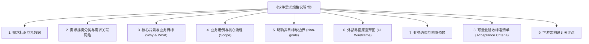

# 需求澄清模块与飞书端沉淀说明书

> **当前版本**：`v0.3.2`（配套规范 `SPEC-REQ-STANDARD-v1.0`）  
> **编写日期**：2026-11-07  
> **归属项目**：AutoDev 独立需求澄清模块 (`src/requirements/`)  
> **状态**：已收敛落地并打通 S2 架构设计交接，服务稳定运行中

---

## 一、本次 Session 演进过程与核心决策全记录

在本次 Session 中，我们围绕“让用户通过移动端/桌面端飞书直接与 AI 需求分析师对话、极简澄清想法、沉淀标准需求规格”的目标，完成了从架构搭建到多轮启发式升级的完整闭环。

### 1. 演进历程与问题解决

| 演进阶段 | 解决的核心问题 | 技术与机制沉淀 |
| --- | --- | --- |
| **阶段 1：独立内聚与安全常驻** | 摆脱外部仓库依赖，在 AutoDev 内实现完全自包含的需求分析师飞书服务 | • `src/requirements/` 独立内聚<br>• 基于官方 WebSocket 长连接（`feishu_daemon.py`）免公网穿透<br>• 强制 Plan Mode / Read-Only 只读沙箱<br>• macOS LaunchAgent 系统守护（`com.autodev.req-bot`） |
| **阶段 2：多渠道呈现层解耦** | 业务语义与展示渠道混杂，难以扩展 Web/微信 | • 提炼 `presentation/` 适配器层<br>• 抽象 `RequirementResponse` / `RequirementChoice`<br>• 实现 `FeishuCardPresenter`（飞书高颜值交互卡片）与 `PlainTextPresenter` |
| **阶段 3：引导式拼图与极简决策** | 模型单次回复长篇大论、技术黑话多、用户无法快速回复 | • 升级 `req-guided-v2` 拼图法（目标->流程->边界->验收）<br>• 单轮严格限制在 250 字内<br>• 收敛为 1、2 选项选择题，支持手机端直接回复 `1` 或 `2` 秒选 |
| **阶段 4：具象业务场景举例** | 抽象概念用户无法感知，不知道怎么抉择 | • 强制约束禁止抽象黑话，每个选项必须给出**具体、生动的日常业务操作场景例子**（如拿书扫码借还） |
| **阶段 5：外部界面原型立体感知** | 纯文字缺乏立体感，用户看不见外部界面长什么样 | • 升级 `req-guided-v3`，支持生成移动端适配的等宽文本线框图（ASCII/Unicode UI Wireframe）<br>• 主动询问原型意愿，口语化指令标准化（“看原型”、“做个原型”） |
| **阶段 6：模块归属与近期关联判断** | 需求容易孤立提出，缺乏全局拓扑与历史链路认知 | • 落地 `context_detector.py` 动态抽取项目主模块、近期 Git 提交和定稿文档<br>• 升级 `req-guided-v4`，强制首轮对**【功能层级归属】**与**【近期功能关联】**做确定性研判 |
| **阶段 7：渐进式演进与网状关系规范** | 需求从模糊到清晰演进，大小需求与网状关系需标准化表达 | • 升级 `req-guided-v5` 支持 Epic/Feature/Sub-feature 粒度与 Parent/Depends-on 关系矩阵<br>• 制定 `SPEC-REQ-STANDARD-v1.0` 渐进式演进规范与 `validator.py` 自动化检查器 |
| **阶段 8：独立模型层与直通 S2 架构设计** | 需求阶段用哪个大模型、怎么调用需独立解耦，定稿后需无缝连接主流水线下一阶段 | • 抽离 `llm_provider.py`：统一读取 `config.yaml` 完整模型 ID（遵循 `docs/MODELS.md`，严禁短别名），支持 `cli_session` 与 `cli_stateless` 双模式及 `/model`、`/mode` 在线切换<br>• 落地 `handoff.py`：定稿通过 `validator.py` 校验后，回复 `启动设计` 或 `/handoff` 自动生成 S1 基线并直通 `S2 架构设计` |

---

## 二、飞书端生成的需求文档类别划分（九大标准分类）

最终在飞书端回复 `定稿`、`总结需求` 或需求 4 块拼图集齐时，系统会生成一份标准的《软件需求规格说明书（草案）》（落盘于 `docs/requirements/REQ-[时间戳].md`）。其分类由以下 **九大标准类别** 构成：



### 九大类别详细定义表

| 序号 | 类别名称（固定二级标题） | 英文标识 | 核心职责与标准内容 |
| :---: | :--- | :--- | :--- |
| **1** | **需求标识与元数据** | Title & Metadata | 包含标准化编号（如 `REQ-CIRCULATION-BORROW`）、需求名称、提出人、分析师、归属项目、定稿时间。 |
| **2** | **需求规模分类与需求关联网络** | Classification & Relations | **【本次重点】**<br>• **需求规模类别**：显式声明为史诗大需求 (Epic)、标准功能 (Feature)、子功能小需求 (Sub-feature) 还是改动增强 (Enhancement)；<br>• **功能层级归属**：明确属于哪个顶层大业务域下的细分子功能，或全新模块；<br>• **需求关联网络**：结构化声明与其他需求的关联矩阵（Parent、Depends-on、Relates-to、Blocks、Supersedes 或 None）。 |
| **3** | **核心背景与业务目标 (Why & What)** | Background & Objectives | 讲清“为什么要做”、“解决什么人在什么场景下的最痛问题”，以及衡量该需求成功的业务结果。 |
| **4** | **业务用例与核心流程 (Scope)** | Scope & Core User Flows | 使用者端到端的正向操作流与异常分支，使用者第一步做什么、第二步做什么、最终得到什么。 |
| **5** | **明确非目标与边界 (Non-goals)** | Non-Goals (Out of Scope) | **【防膨胀红线】** 明确列出本期坚决不做的特性（如“本期不接入第三方物流”、“暂不支持多语言”），严格锁死范围。 |
| **6** | **外部界面原型草图 (UI Wireframe)** | UI Wireframe / Mockup | 使用立体、直观的等宽文本线框图（ASCII/Unicode Box-Drawing），真实呈现外部界面的排版、输入项、核心按钮与状态提示。 |
| **7** | **业务约束与前置依赖** | Constraints & Prerequisites | 梳理前置业务条件（如必须拥有某种身份权限）、外部依赖（如飞书应用消息推送权限）及合规限制。 |
| **8** | **可量化验收标准清单 (Acceptance Criteria)** | Acceptance Criteria (AC) | 站在使用者视角的验收测试用例清单（Scenario-based 或 Given-When-Then），确保下游做完后能够按步骤黑盒验证。 |
| **9** | **下游架构设计关注点** | Downstream Design Focus | 提炼给下游 S2 架构设计阶段决策的问题（如接口协议选型、高并发考虑），但需求文档本身不越权给出代码实现。 |

---

## 三、最终生成的需求文档模样（标准样例示范）

以下为飞书端与用户充分交流后，执行 `定稿` 最终沉淀的标准需求文档完整样例（100% 符合 [`SPEC-REQ-STANDARD-v1.0`](../../specs/REQUIREMENT_SPEC_STANDARD.md) 并通过 `validator.py` 校验）：

````markdown
# 软件需求规格说明书（草案）

## 1. 需求标识与元数据
- **需求编号**：REQ-CIRCULATION-MOBILE_BORROW-20261107
- **需求名称**：移动端扫码图书借阅与到期提醒
- **提出人**：项目负责人
- **分析师**：AutoDev Requirement Bot (req-guided-v5)
- **归属项目**：`/Users/bai/code/autodev`
- **定稿时间**：2026-11-07 16:15:00

---

## 2. 需求规模分类与需求关联网络
- 🏷️ **需求规模与粒度类别**：
  **标准功能需求 (Feature)**（在 requirements 模块内形成完整借阅闭环，无需跨项目拆解）。
- 📂 **功能层级与模块归属**：
  本项目划分为四大业务域（cockpit, dashboard, driver, requirements）。本功能归属于 **【requirements / 业务能力与用户交互】** 域下的细分子操作（终端流通借还分支）。
- 🔗 **与其他需求的关系矩阵 (Relationship Network)**：
  - `Parent（所属父需求）`：None（本身为标准功能）
  - `Depends-on（前置依赖）`：`REQ-USER-AUTH`（依赖用户身份认证能力）
  - `Relates-to（业务协同）`：`REQ-FEISHU-CARD`（强协同：复用飞书交互卡片呈现层与审批白名单）
  - `Blocks（后置阻塞）`：`REQ-CIRCULATION-STAT`（为后续借阅数据大屏提供事实数据源）

---

## 3. 核心背景与业务目标 (Why & What)
- **业务背景**：
  公司图书架上的书籍目前依靠纸质登记表借阅，常出现“借了不登记”、“超期无人知晓”、“借阅人离职未归还”等丢失情况。
- **业务目标**：
  让员工在手机飞书上 5 秒内完成扫码自主借书；在还书到期前 3 天通过飞书交互卡片精准提醒，提升图书周转率，借阅丢失率降低为零。

---

## 4. 业务用例与核心流程 (Scope)
- **核心用例 1：员工扫码借书**
  1. 员工在手机端使用扫一扫识别图书条形码；
  2. 系统展示图书当前信息（书名、藏书位置、借期 30 天）；
  3. 员工点击【确认借出】，系统即时变更该书状态为“已借出”，并记录借阅人；
  4. 员工飞书收到一条“借阅成功凭据”卡片。
- **核心用例 2：到期前自动催还**
  1. 在借期截止前 3 天早上 10:00，系统向借阅人发送一条催还待办卡片；
  2. 员工可在卡片中直接点击【一键续借 15 天】或前往前台还书。

---

## 5. 明确非目标与边界 (Non-goals)
- ❌ **本期不实现纸质书损坏罚款计费系统**（仅记录逾期天数，不涉及真实财务扣款）；
- ❌ **本期不开放外部访客借阅**（仅允许企业内部已授权员工借阅）；
- ❌ **暂不接入自动 RFID 门禁感应**（依托条形码与飞书扫码，不增加硬件成本）。

---

## 6. 外部界面原型草图 (UI Wireframe)
```text
┌────────────────────────────────────────┐
│ 📚 图书借还工作台                      │
├────────────────────────────────────────┤
│ [ 📷 扫一扫借书 ]                      │
├────────────────────────────────────────┤
│ 当前扫码图书：                         │
│ • 书名：《代码整洁之道》                │
│ • 馆藏位置：A架-03号                   │
│ • 借出期限：30 天 (归还日: 12月07日)   │
│ • 借阅人：当前飞书员工 (张三)          │
├────────────────────────────────────────┤
│ [ 🚀 确认借出 ]     [ ❌ 取消 ]        │
├────────────────────────────────────────┤
│ 💡 提示：借出后将在到期前 3 天收到提醒   │
└────────────────────────────────────────┘
```

---

## 7. 业务约束与前置依赖
- **身份认证约束**：使用者必须为飞书组织内激活员工，具备系统白名单权限；
- **设备依赖**：手机端必须具备飞书摄像头扫码权限；
- **通知时效**：催还消息限定在工作日工作时间（09:00~18:00）发送，避免非工作时间骚扰。

---

## 8. 可量化验收标准清单 (Acceptance Criteria)
1. **场景 1（正常借出）**：
   - *Given* 员工处于登录白名单且图书状态为“在架可借”；
   - *When* 员工扫描条形码并点击【确认借出】；
   - *Then* 图书状态即刻转为“已借出”，借阅人绑定该员工，借阅记录产生，耗时 ≤ 2 秒。
2. **场景 2（已被他人借出防并发）**：
   - *Given* 图书已被同事李四借出；
   - *When* 员工张三扫码尝试借出；
   - *Then* 界面提示“该书已被李四于 11-05 借出，预计还书时间 12-05”，阻断借出操作。
3. **场景 3（到期提醒触发）**：
   - *Given* 存在借阅倒计时 ≤ 3 天的记录；
   - *When* 触发每日定时巡检；
   - *Then* 借阅人飞书收到【图书到期催还卡片】，卡片内包含图书名称与归还倒计时。

---

## 9. 下游架构设计关注点
1. 扫码高并发下图书借阅状态的原子并发控制方案；
2. 催还通知定时巡检是采用 Cron 轮询还是事件驱动的延时任务队列；
3. 图书条码索引数据结构选型。
````

---

## 四、独立大模型调用层与直通 S2 架构设计交接机制（A1 + B1）

### 1. 独立大模型与调用方式层（[`src/requirements/llm_provider.py`](../../../src/requirements/llm_provider.py)）
为了将“需求澄清阶段用哪一个大模型、用什么方式调用”与飞书对话逻辑彻底解耦，本模块提取了独立的 `llm_provider.py`：
- **唯一完整模型 ID 真源（遵循 [`docs/MODELS.md`](../../MODELS.md)）**：config.yaml 现在以 agent_registry 引用 config/agents.toml，可用机器文件整体覆盖；llm_provider 仅加载当前登记，不再补入内置备用。ModelSpec.validate 拦截 sonnet、opus 等模型 ID 短别名。以下为迁移时保留的逻辑名称，实际 ID 以有效注册表为准：
  - `claude-sonnet` → `ai-code-with/claude-sonnet-5-5`（默认需求分析师引擎，兼顾响应速度与归纳质量）
  - `claude-opus` → `ai-code-with/claude-opus-5-5`
  - `codex`（或别名 `gpt`）→ `gpt-6-sol`
  - `agy`（或别名 `gemini`）→ `gemini-4-argon-high`
- **双调用方式（`cli_session` / `cli_stateless`）**：
  - `cli_session`（默认）：利用 CLI 原生 `--resume <session_id>` 保持多轮上下文，同时在本地 `ReqSessionStore` 同步保存最近 10 轮问答历史；
  - `cli_stateless`：每次独立无状态单次调用，由 `inject_stateless_history()` 自动将前序问答上下文注入本轮 Prompt。当用户在对话中途通过 `/model` 跨模型或跨厂商切换时，系统自动清空旧 CLI 的 `session_id` 并无缝利用本地 `history` 续接对话！

### 2. 飞书端与主流水线 `S2 架构设计` 的桥接交接器（[`src/requirements/handoff.py`](../../../src/requirements/handoff.py)）
由于飞书端产出的 9 章节《软件需求规格说明书》已经完成了比传统 `S1-analysis` 更深入的交互澄清与边界锁定，因此采用 **直通 S2 架构设计（跳过重复 S1）** 的交接方案：
1. **前置程序化门禁**：`handoff_srs_to_pipeline()` 首先调用 `validate_requirement_spec()` 校验 `REQ-xxx.md` 是否满足 `RULE-01 ~ RULE-09`；未通过校验的文档严禁进入流水线；
2. **模型与角色预检**：经 config.yaml 引用共享注册表，核对设计角色能力。现有 check_vendors 仍执行旧跨厂商硬校验；D019 已允许分级/降级/免审，但执行策略尚未迁移，不能将旧限制当作新规则；
3. **自动生成 S1 基线与激活需求**：
   - 分配正式运行号 `R{YYYYMMDD}-{NNN}`，将完整 SRS 写入 `workspace/requests/active/{rid}.md`；
   - 提取 SRS 核心元数据并在 `workspace/runs/{rid}/S1-analysis/round-1/` 下生成符合流水线契约的 `analysis.md`（`verdict: ACCEPT` + 完整 SRS 附文）与 `done.json`；
4. **直通初始化 S2**：将 `workspace/runs/{rid}/state.json` 直接置为 `stage: "S2"`, `round: 1`, `step.role: "designer"` (`claude-opus`)，使主流水线 `Controller` 与看板无需任何硬编码分支即可直接从 `S2 架构设计` 启动推进！
5. **两种触发方式**：
   - **飞书内一键触发**：定稿后直接发送 `启动设计`、`移交设计` 或 `/handoff`；
   - **命令行触发**：`PYTHONPATH=src python3 -m requirements.handoff --req docs/requirements/REQ-xxx.md`。

---

## 五、后续演进建议与待办事项

1. **落盘触发策略增强**：支持用户在飞书端直接点击卡片上的【定稿归档】与【启动设计】按钮，避免手动键入文本；
2. **多项目关联联动**：支持跨仓库/跨项目对比近期类似需求；
3. **飞书实时进度回推**：当 `S2 架构设计` 与 `S3 设计审查` 完成或遇到人工关口时，主动向飞书对话回推设计摘要卡片。
