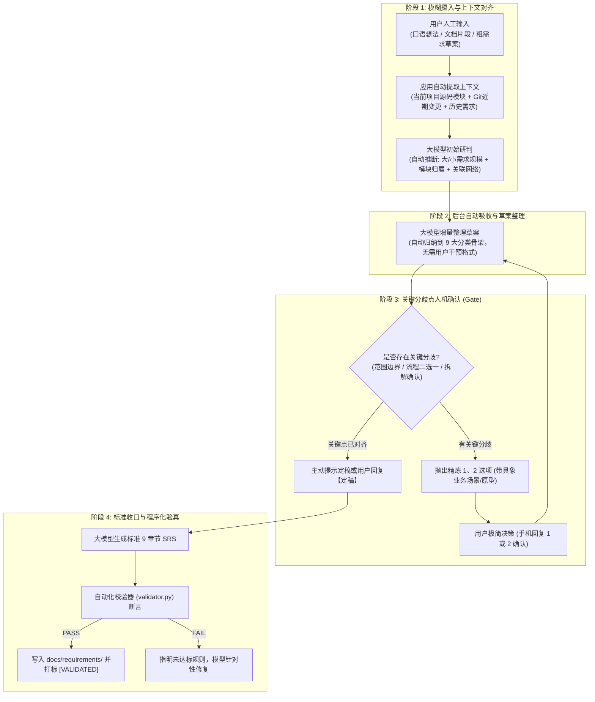
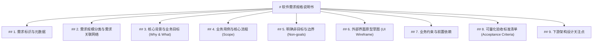

# 软件需求规格说明书产出规范与校验标准 (SRS Standard v1.0)

> **文档标识**：`SPEC-REQ-STANDARD-v1.0`  
> **编制日期**：2026-11-07  
> **适用范围**：AutoDev 需求分析与澄清阶段的所有输出产物，即下游 S2 架构设计阶段的标准输入契约。  
> **核心原则**：**输入可发散，输出必收敛；人机可共读，程序可自检。**

---

## 一、规范背景与契约目标

在 AutoDev 流水线中，需求分析阶段是整个软件工程的源头。
- **输入的灵活性**：用户可以通过飞书、命令行、Web 等不同客户端以口语化、碎片化、发散的方式提出想法；
- **输出的确定性**：最终交付的《软件需求规格说明书（草案）》（以下简称 SRS）必须遵循严格的结构化标准。它是下游 **S2 架构设计** 和 **S3 设计审查** 的唯一事实依据；
- **程序化校验要求**：本规范不仅是大模型输出的 Prompt 模板约束，更是**自动化检查程序（Validator / Linter）**的断言基准。任何未通过程序化规则检查的产物，将被系统自动拦截并打回重整。

---

## 二、文件物理规范与存储契约

1. **存储路径**：
   - 目标项目工程下的 `docs/requirements/` 目录。
2. **文件命名规范**：
   - 格式：`REQ-{MODULE}-{ACTION}-{YYYYMMDD}.md`
   - 说明：
     - `{MODULE}`：所属大功能模块英文大写代号（如 `CIRCULATION`、`COCKPIT`、`AUTH`）；
     - `{ACTION}`：核心业务动词短语（如 `MOBILE_BORROW`、`STATUS_CHECK`）；
     - `{YYYYMMDD}`：定稿日期（如 `20261107`）。
   - 示例：`REQ-CIRCULATION-MOBILE_BORROW-20261107.md`
3. **字符编码与换行**：
   - 统一采用 `UTF-8` 无 BOM 编码，换行符统一为 `LF`（`\n`）。

---

## 三、从模糊到清晰的渐进式演进流程规范 (Progressive Elaboration)

真实场景下的需求极少是一蹴而就的。本规范明确定义从“最初模糊的人工想法”到“最终严格标准文档”的 **四阶段演进生命周期**：



### 演进生命周期的四项核心原则：
1. **输入端宽松容错**：人工可以输入零散想法、会议纪要、甚至上传一段未经整理的粗糙业务文档，系统均需无障碍接收并启动分析；
2. **机器端主动合成**：系统必须结合当前代码工程的现有模块架构（`src/`）、最近的 Git 提交历史以及已定稿的历史需求，由大模型在后台主动做关联、拼图与分类整理，而不是要求人类逐字段填写表单；
3. **交互端抓大放小**：模型不琐碎追问，日常细节由大模型结合最佳实践补齐；**仅在关键分歧点（如大需求是否拆解、业务流程走向二选一、核心非目标边界）向用户发起确认**，并收敛为带生动业务例子的 1、2 选项；
4. **输出端严格验真**：当讨论成熟进入定稿时，输出文档必须 100% 收敛至九大章节，并经由 `validator.py` 自动化断言通过后方可移交下游。

---

## 四、九大核心章节结构契约（必填）

一份合格的 SRS 必须严格按顺序包含以下 **九大标准章节**，各级标题文字必须与规范严格一致，缺失任意一节程序检查即判为 FAIL。



---

### 1. 需求标识与元数据
- **固定标题**：`## 1. 需求标识与元数据`
- **格式要求**：键值对无序列表，包含以下 6 个标准属性：
  - `- **需求编号**`：与文件名一致的 REQ 编号；
  - `- **需求名称**`：简明准确的中文业务名称（≤ 25 字）；
  - `- **提出人**`：提出者标识（如飞书用户名或 Open ID）；
  - `- **分析师**`：负责引导澄清的 Agent 与提示词版本号；
  - `- **归属项目**`：目标项目绝对路径或仓库标识；
  - `- **定稿时间**`：标准 ISO 8601 或 `YYYY-MM-DD HH:MM:SS` 时间戳。

### 2. 需求规模分类与需求关联网络 (Classification & Relations)
- **固定标题**：`## 2. 需求规模分类与需求关联网络`
- **核心目的**：明确需求的粒度规模（大需求还是小需求），并建立纵向父子与横向依赖的需求关系网络（拓扑图谱），杜绝孤岛式开发。
- **格式要求**：必须显式包含以下三大维度：
  1. 🏷️ **需求规模与粒度类别**：必须显式声明属于以下四类之一：
     - `史诗级大需求 (Epic)`：涉及跨模块或全链路复杂业务，建议拆解实施；
     - `标准功能需求 (Feature)`：单一模块内具备端到端闭环的标准功能；
     - `子功能小需求 (Sub-feature)`：属于某个大功能/大需求下的具体操作切片；
     - `体验与改动增强 (Enhancement)`：对已有运行功能的局部微调、字段补充或体验优化。
  2. 📂 **功能层级与模块归属**：明确指出挂载在系统的哪个一级主业务域/核心模块下，属于哪个分支；
  3. 🔗 **与其他需求的关系矩阵 (Relationship Network)**：明确列出与其他具体需求编号（REQ-ID）的关系类型：
     - `Parent（所属父需求）`：如果本需求是小需求，必须指向其所属的上级大需求；
     - `Depends-on（前置依赖）`：必须先完成哪项需求，本功能才能运行或测试；
     - `Relates-to（业务协同）`：与哪项需求在同一业务链条上、共享数据实体或组件；
     - `Blocks（后置阻塞）`：本需求完成后将解锁哪项后续需求；
     - `Supersedes（演进替代）`：对哪项历史需求（或前序版本非目标）的重新实现或增强；
     - *(若确属孤立功能，显式填写 `None（独立无外部关联）`)*。

### 3. 核心背景与业务目标 (Why & What)
- **固定标题**：`## 3. 核心背景与业务目标 (Why & What)`
- **核心目的**：讲清价值与根因。
- **格式要求**：
  - `- **业务背景**`：阐述当前现状、使用者痛点、未被满足的操作场景；
  - `- **业务目标**`：陈述功能上线后能够带来的客观业务收益或效率提升（避免空话）。

### 4. 业务用例与核心流程 (Scope)
- **固定标题**：`## 4. 业务用例与核心流程 (Scope)`
- **核心目的**：清晰勾勒端到端使用闭环。
- **格式要求**：
  - 必须按使用者角色梳理至少 1 个完整的核心正向用例，并覆盖典型分支；
  - 采用数字编号列表：`1. 第一步... 2. 第二步... 3. 最终得到...`；
  - 严禁出现底层数据库 SQL、代码类名等技术黑话，必须为使用者可见的业务行为。

### 5. 明确非目标与边界 (Non-goals)
- **固定标题**：`## 5. 明确非目标与边界 (Non-goals)`
- **核心目的**：**【范围防膨胀红线】** 明确划定本期坚决不做的边界。
- **格式要求**：
  - 列表项必须包含 `❌` 标记；
  - 至少列出 2 项显式排除的范围（如“本期不实现批量导入”、“暂不支持跨平台同步”）；
  - 严禁空缺，若确实无特殊排除项，必须写明“经充分研讨，本期无额外排除范围”。

### 6. 外部界面原型草图 (UI Wireframe)
- **固定标题**：`## 6. 外部界面原型草图 (UI Wireframe)`
- **核心目的**：让需求具象立体，为下游 UI/交互设计提供事实依据。
- **格式要求**：
  - 必须包含至少一个带有 ```text 标记的等宽文本代码块；
  - 采用 ASCII/Unicode 边框字符（如 `┌─┐│└─┘`、`+-+|`）绘制低保真页面线框；
  - 线框内必须清晰标示：**页面标题栏**、**核心输入元素**（如 `[ 输入框 ]`）、**操作按钮**（如 `[ 提交 ]`）、**数据展示区**；
  - 线框宽度推荐在 35~45 字符之间，保证移动端飞书与 PC 端均良好适配。

### 7. 业务约束与前置依赖
- **固定标题**：`## 7. 业务约束与前置依赖`
- **格式要求**：
  - `- **身份与权限约束**`：哪些角色的用户可操作该功能；
  - `- **环境与前置依赖**`：所需的前置条件（如网络、硬件摄像头、第三方系统授权）；
  - `- **规则约束**`：频次、时效、业务窗口限制（如每天仅允许发送一次）。

### 8. 可量化验收标准清单 (Acceptance Criteria)
- **固定标题**：`## 8. 可量化验收标准清单 (Acceptance Criteria)`
- **核心目的**：下游 S5 检查与 S8 验收的断言源泉，支持可验证的黑盒验收。
- **格式要求**：
  - 至少列出 2 个不同场景（包含 1 个正向场景、1 个异常或边界场景）；
  - 格式规范（推荐 BDD 或明确的条件步骤）：
    - **场景 N（场景名称）**：
      - *Given*（前置条件）
      - *When*（触发动作）
      - *Then*（预期结果与可量化断言指标）

### 9. 下游架构设计关注点
- **固定标题**：`## 9. 下游架构设计关注点`
- **核心目的**：给下游 S2 架构设计提炼关键技术考量，同时自我克制不越权写代码。
- **格式要求**：
  - 列出 1~3 个技术架构或数据模型设计时需重点评估的要点（如并发锁机制、缓存失效策略、消息可靠投递）；
  - 严禁直接给出数据库建表 SQL 或具体的程序实现代码。

---

## 五、程序化校验规则定义 (Linter Rules)

自动化验证程序（[`src/requirements/validator.py`](../../src/requirements/validator.py)）将按以下规则逐项断言，任一 BLOCKER/MAJOR 规则失败即整体验收失败：

| 规则编号 | 规则名称 | 校验级别 | 检查逻辑与通过标准 |
| :---: | :--- | :---: | :--- |
| **RULE-01** | 文件编码与命名 | BLOCKER | 文件必须是 UTF-8；文件名必须符合 `REQ-*.md` 命名范式。 |
| **RULE-02** | 章节完整性 | BLOCKER | 必须严格包含 9 个 `## N.` 二级标题，文字字样与规范 100% 匹配。 |
| **RULE-03** | 需求类别与拓扑矩阵 | BLOCKER | 第 2 节内必须同时包含 `需求规模`、`模块归属` 与 `需求关系`（或 Parent/Depends-on/Relates-to/None），且内容不可为空。 |
| **RULE-04** | 核心背景与目标 | MAJOR | 第 3 节内必须同时包含 `业务背景` 与 `业务目标` 字段。 |
| **RULE-05** | 非目标边界声明 | BLOCKER | 第 5 节内必须至少包含 1 个带有 `❌` 或 `-` 的非目标条目，严禁无边界。 |
| **RULE-06** | 界面原型线框图 | MAJOR | 第 6 节必须包含至少一个 ```text 且有效行数 ≥ 5 行的文本线框图。 |
| **RULE-07** | 验收标准可验证 | BLOCKER | 第 8 节必须包含具体场景条目（如 `场景 1`、`Scenario` 或编号列表），且包含触发条件与预期结果。 |
| **RULE-08** | 禁止技术越权 | BLOCKER | 全文不得包含 `CREATE TABLE`、`ALTER TABLE`、`SELECT ... FROM`、`INSERT INTO`、`def `、`class ` 等业务代码或 SQL 实现。 |
| **RULE-09** | 篇幅与有效性 | BLOCKER / MINOR | 全文非空字符数须 ≥ 300 字符（低于 300 报 BLOCKER，高于 15000 报 WARN），防止空泛或万字发散。 |

---

## 六、程序化检查器实现（Python 契约接口）

AutoDev 已在 [`src/requirements/validator.py`](../../src/requirements/validator.py) 实现该契约接口，在 `feishu_daemon.py` 定稿落盘时自动调用：

```python
from requirements.validator import ValidationResult, validate_requirement_spec

# 返回 ValidationResult(is_valid: bool, errors: list[str], warnings: list[str])
result: ValidationResult = validate_requirement_spec(markdown_content)
if not result.is_valid:
    # 拦截或标记未通过的具体 RULE 编号与原因
    print("校验未通过:", result.errors)
```

其核心检查项与第五节 `RULE-02` ~ `RULE-09` 一一对应：
1. **章节完备性（RULE-02）**：逐一断言 `REQUIRED_SECTIONS` 中的 9 个二级标题；
2. **需求规模与拓扑矩阵（RULE-03）**：断言第 2 节同时包含规模类别（`需求规模`/`大需求`/`小需求`/`Epic`/`Feature`/`Sub-feature`）、模块归属（`功能层级归属`/`模块归属`）与关联关系（`需求关联`/`Parent`/`Depends-on`/`Relates-to` 等）；
3. **背景目标与非目标边界（RULE-04 / RULE-05）**：断言第 3 节含 `业务背景` 与 `业务目标`，第 5 节含 `❌` 或 `-` 排除项；
4. **低保真线框图与验收场景（RULE-06 / RULE-07）**：断言第 6 节含 ` ```text ` 代码块，第 8 节含具体验收场景；
5. **防技术越权与篇幅（RULE-08 / RULE-09）**：正则拦截 SQL/Python 函数类定义，校验字符长度区间。

---

## 七、标准范本（Gold Standard Example）

参见配套的标准模版样例：[`docs/modules/requirements/feishu-requirement-bot.md`](../modules/requirements/feishu-requirement-bot.md) 第三节。

---

## 八、向主流水线下一阶段（S2 架构设计）的标准交接协议

当一份 `REQ-xxx.md` 通过本规范第五、六节的程序化校验（`ValidationResult.is_valid == True`）后，即可通过阶段交接器 [`src/requirements/handoff.py`](../../src/requirements/handoff.py) 直接移交至主流水线 **S2 架构设计** 阶段（跳过重复的 S1 需求分析）：

1. **输入前置断言**：`handoff_srs_to_pipeline()` 强制执行 `validate_requirement_spec()`，任何违反 `RULE-01 ~ RULE-09` 的文档均被拒绝移交；
2. **产物映射契约**：
   - `workspace/requests/active/{rid}.md`：写入完整 9 章节 SRS 原文（供 S2 架构师与 S3 设计审查者逐句做“原文对照”）；
   - `workspace/runs/{rid}/S1-analysis/round-1/{analysis.md, done.json}`：由交接器从 SRS 第 1、3、4、8 节确定性提取摘要、范围与验收标准生成 `verdict: ACCEPT` 基线产物；
   - `workspace/runs/{rid}/state.json`：初始 `stage` 直接设为 `"S2"`，`round` 设为 `1`，`step` 指向 `S2-design/round-1`（角色 `designer`）。
