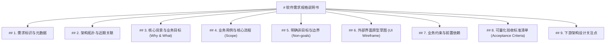

# 软件需求规格说明书产出规范与校验标准 (SRS Standard v1.0)

> **文档标识**：`SPEC-REQ-STANDARD-v1.0`  
> **编制日期**：2026-11-07  
> **适用范围**：AutoDev 需求分析与澄清阶段的所有输出产物，即下游 S2 架构设计阶段的标准输入契约。  
> **核心原则**：**输入可发散，输出必收敛；人机可共读，程序可自检。**

---

## 一、规范背景与契约目标

在 AutoDev 流水线中，需求分析阶段是整个软件工程的源头。
- **输入的灵活性**：用户可以通过飞书、命令行、Web 等不同客户端以口语化、碎片化、发散的方式提出想法；
- **输出的确定性**：最终交付的《软件需求规格说明书（草案）》（以下简称 SRS）必须遵循严格的结构化标准。它是下游 **S2 架构设计** 和 **S3 设计审查** 的唯一事实依据；
- **程序化校验要求**：本规范不仅是大模型输出的 Prompt 模板约束，更是**自动化检查程序（Validator / Linter）**的断言基准。任何未通过程序化规则检查的产物，将被系统自动拦截并打回重整。

---

## 二、文件物理规范与存储契约

1. **存储路径**：
   - 目标项目工程下的 `docs/requirements/` 目录。
2. **文件命名规范**：
   - 格式：`REQ-{MODULE}-{ACTION}-{YYYYMMDD}.md`
   - 说明：
     - `{MODULE}`：所属大功能模块英文大写代号（如 `CIRCULATION`、`COCKPIT`、`AUTH`）；
     - `{ACTION}`：核心业务动词短语（如 `MOBILE_BORROW`、`STATUS_CHECK`）；
     - `{YYYYMMDD}`：定稿日期（如 `20261107`）。
   - 示例：`REQ-CIRCULATION-MOBILE_BORROW-20261107.md`
3. **字符编码与换行**：
   - 统一采用 `UTF-8` 无 BOM 编码，换行符统一为 `LF`（`\n`）。

---

## 三、九大核心章节结构契约（必填）

一份合格的 SRS 必须严格按顺序包含以下 **九大标准章节**，各级标题文字必须与规范严格一致，缺失任意一节程序检查即判为 FAIL。



---

### 1. 需求标识与元数据
- **固定标题**：`## 1. 需求标识与元数据`
- **格式要求**：键值对无序列表，包含以下 6 个标准属性：
  - `- **需求编号**`：与文件名一致的 REQ 编号；
  - `- **需求名称**`：简明准确的中文业务名称（≤ 25 字）；
  - `- **提出人**`：提出者标识（如飞书用户名或 Open ID）；
  - `- **分析师**`：负责引导澄清的 Agent 与提示词版本号；
  - `- **归属项目**`：目标项目绝对路径或仓库标识；
  - `- **定稿时间**`：标准 ISO 8601 或 `YYYY-MM-DD HH:MM:SS` 时间戳。

### 2. 架构拓扑与近期关联
- **固定标题**：`## 2. 架构拓扑与近期关联`
- **核心目的**：建立全局模块树与历史演进脉络，杜绝孤岛式开发。
- **格式要求**：必须显式包含两个子段落（或无序列表）：
  - `📂 **功能层级归属**`：明确当前功能挂载在系统的哪个一级主业务域/核心包下，属于其哪个细分业务分支；若是全新领域，需明确声明为“全新独立模块”并说明未来归宿；
  - `🔗 **近期功能关联**`：基于近期 Git 变更记录或历史需求，明确指出与近期哪个功能存在强关联（业务链路承接、实体/能力复用、前后依赖、还是彼此独立）。

### 3. 核心背景与业务目标 (Why & What)
- **固定标题**：`## 3. 核心背景与业务目标 (Why & What)`
- **核心目的**：讲清价值与根因。
- **格式要求**：
  - `- **业务背景**`：阐述当前现状、使用者痛点、未被满足的操作场景；
  - `- **业务目标**`：陈述功能上线后能够带来的客观业务收益或效率提升（避免空话）。

### 4. 业务用例与核心流程 (Scope)
- **固定标题**：`## 4. 业务用例与核心流程 (Scope)`
- **核心目的**：清晰勾勒端到端使用闭环。
- **格式要求**：
  - 必须按使用者角色梳理至少 1 个完整的核心正向用例，并覆盖典型分支；
  - 采用数字编号列表：`1. 第一步... 2. 第二步... 3. 最终得到...`；
  - 严禁出现底层数据库 SQL、代码类名等技术黑话，必须为使用者可见的业务行为。

### 5. 明确非目标与边界 (Non-goals)
- **固定标题**：`## 5. 明确非目标与边界 (Non-goals)`
- **核心目的**：**【范围防膨胀红线】** 明确划定本期坚决不做的边界。
- **格式要求**：
  - 列表项必须包含 `❌` 标记；
  - 至少列出 2 项显式排除的范围（如“本期不实现批量导入”、“暂不支持跨平台同步”）；
  - 严禁空缺，若确实无特殊排除项，必须写明“经充分研讨，本期无额外排除范围”。

### 6. 外部界面原型草图 (UI Wireframe)
- **固定标题**：`## 6. 外部界面原型草图 (UI Wireframe)`
- **核心目的**：让需求具象立体，为下游 UI/交互设计提供事实依据。
- **格式要求**：
  - 必须包含至少一个带有 ```text 标记的等宽文本代码块；
  - 采用 ASCII/Unicode 边框字符（如 `┌─┐│└─┘`、`+-+|`）绘制低保真页面线框；
  - 线框内必须清晰标示：**页面标题栏**、**核心输入元素**（如 `[ 输入框 ]`）、**操作按钮**（如 `[ 提交 ]`）、**数据展示区**；
  - 线框宽度推荐在 35~45 字符之间，保证移动端飞书与 PC 端均良好适配。

### 7. 业务约束与前置依赖
- **固定标题**：`## 7. 业务约束与前置依赖`
- **格式要求**：
  - `- **身份与权限约束**`：哪些角色的用户可操作该功能；
  - `- **环境与前置依赖**`：所需的前置条件（如网络、硬件摄像头、第三方系统授权）；
  - `- **规则约束**`：频次、时效、业务窗口限制（如每天仅允许发送一次）。

### 8. 可量化验收标准清单 (Acceptance Criteria)
- **固定标题**：`## 8. 可量化验收标准清单 (Acceptance Criteria)`
- **核心目的**：下游 S5 检查与 S8 验收的断言源泉，支持可验证的黑盒验收。
- **格式要求**：
  - 至少列出 2 个不同场景（包含 1 个正向场景、1 个异常或边界场景）；
  - 格式规范（推荐 BDD 或明确的条件步骤）：
    - **场景 N（场景名称）**：
      - *Given*（前置条件）
      - *When*（触发动作）
      - *Then*（预期结果与可量化断言指标）

### 9. 下游架构设计关注点
- **固定标题**：`## 9. 下游架构设计关注点`
- **核心目的**：给下游 S2 架构设计提炼关键技术考量，同时自我克制不越权写代码。
- **格式要求**：
  - 列出 1~3 个技术架构或数据模型设计时需重点评估的要点（如并发锁机制、缓存失效策略、消息可靠投递）；
  - 严禁直接给出数据库建表 SQL 或具体的程序实现代码。

---

## 四、程序化校验规则定义 (Linter Rules)

自动化验证程序（如 `validate_requirement_spec.py`）将按以下规则逐项断言，任一规则失败即整体验收失败：

| 规则编号 | 规则名称 | 校验级别 | 检查逻辑与通过标准 |
| :---: | :--- | :---: | :--- |
| **RULE-01** | 文件编码与命名 | BLOCKER | 文件必须是 UTF-8；文件名必须符合 `REQ-*.md` 命名范式。 |
| **RULE-02** | 章节完整性 | BLOCKER | 必须严格包含 9 个 `## N.` 二级标题，文字字样与规范 100% 匹配。 |
| **RULE-03** | 架构拓扑双维度 | BLOCKER | 第 2 节内必须同时包含 `功能层级归属` 与 `近期功能关联` 标记，且内容不可为空。 |
| **RULE-04** | 核心背景与目标 | MAJOR | 第 3 节内必须同时包含 `业务背景` 与 `业务目标` 字段。 |
| **RULE-05** | 非目标边界声明 | BLOCKER | 第 5 节内必须至少包含 1 个带有 `❌` 或 `-` 的非目标条目，严禁无边界。 |
| **RULE-06** | 界面原型线框图 | MAJOR | 第 6 节必须包含包含至少一个 ```text 且行数 ≥ 5 行的文本线框图。 |
| **RULE-07** | 验收标准可验证 | BLOCKER | 第 8 节必须包含至少 2 个场景，且场景内必须包含触发条件与预期结果。 |
| **RULE-08** | 禁止技术越权 | BLOCKER | 全文不得包含 `CREATE TABLE`、`def `、`class `、`import ` 等业务代码实现（原型除外）。 |
| **RULE-09** | 篇幅与有效性 | MINOR | 全文非空有效字数须在 600 ~ 3000 字之间，防止出现过短空泛或万字发散。 |

---

## 五、程序化检查器实现（Python 契约接口）

AutoDev 需求检查程序可在流水线或机器人后台无缝调用：

```python
# 示例校验函数原型
from typing import NamedTuple

class ValidationResult(NamedTuple):
    is_valid: bool
    errors: list[str]
    warnings: list[str]

def validate_requirement_doc(content: str) -> ValidationResult:
    """自动对传入的 Markdown 需求规格内容进行程序化规则检查。"""
    errors = []
    warnings = []
    
    # 1. 检查九大章节标题是否存在
    required_sections = [
        "## 1. 需求标识与元数据",
        "## 2. 架构拓扑与近期关联",
        "## 3. 核心背景与业务目标 (Why & What)",
        "## 4. 业务用例与核心流程 (Scope)",
        "## 5. 明确非目标与边界 (Non-goals)",
        "## 6. 外部界面原型草图 (UI Wireframe)",
        "## 7. 业务约束与前置依赖",
        "## 8. 可量化验收标准清单 (Acceptance Criteria)",
        "## 9. 下游架构设计关注点",
    ]
    for sec in required_sections:
        if sec not in content:
            errors.append(f"[RULE-02] 缺失必备章节: {sec}")
            
    # 2. 检查线框图代码块
    if "```text" not in content:
        errors.append("[RULE-06] 第 6 节必须包含 ```text 代码块形式的低保真线框图")
        
    # 3. 检查架构拓扑
    if "功能层级归属" not in content or "近期功能关联" not in content:
        errors.append("[RULE-03] 第 2 节必须显式分析【功能层级归属】与【近期功能关联】")
        
    # 4. 检查技术越权
    forbidden_tokens = ["CREATE TABLE", "SELECT * FROM", "INSERT INTO"]
    for token in forbidden_tokens:
        if token in content:
            errors.append(f"[RULE-08] 需求阶段严禁技术越权编写 SQL/代码实现: 发现 '{token}'")

    return ValidationResult(is_valid=len(errors) == 0, errors=errors, warnings=warnings)
```

---

## 六、标准范本（Gold Standard Example）

参见配套的标准模版样例：[`docs/modules/requirements/feishu-requirement-bot.md`](docs/modules/requirements/feishu-requirement-bot.md) 第三节。
